# Proyecto 1 · Mi web en AWS — Librería Tinta

**Alumno:** Oscar Egosa
**Módulo:** Introducción a la Nube Pública (2º DAW)
**Entorno:** AWS Academy Learner Lab · región `us-east-1`

> 🎥 **Vídeo de presentación y demostración:** https://youtu.be/6Q_U_3bta2U

## Índice

1. [Descripción y arquitectura](#1-descripción-y-arquitectura)
2. [B1. La red](#2-b1-la-red)
3. [B2. La seguridad](#3-b2-la-seguridad)
4. [B3. El servidor web](#4-b3-el-servidor-web)
5. [B4. Presupuesto](#5-b4-presupuesto)
6. [Nivel medio: DNS ponderado con Route 53](#6-nivel-medio-dns-ponderado-con-route-53)
7. [Nivel avanzado: despliegue con la AWS CLI](#7-nivel-avanzado-despliegue-con-la-aws-cli)
8. [Uso de IA](#8-uso-de-ia)
9. [Estructura del repositorio](#9-estructura-del-repositorio)

---

## 1. Descripción y arquitectura

Librería Tinta es una librería de barrio que necesita una web sencilla, segura y fácil de volver a desplegar. La web se ejecuta en una instancia EC2 con nginx, dentro de una red diseñada desde cero.

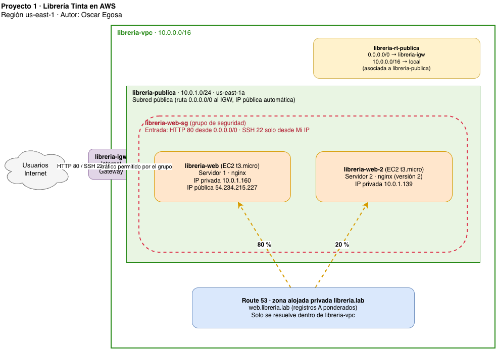

La arquitectura tiene estos elementos:

- **VPC** `libreria-vpc` (10.0.0.0/16)
- **Subred pública** `libreria-publica` (10.0.1.0/24, `us-east-1a`)
- **Internet Gateway** `libreria-igw`
- **Tabla de rutas** `libreria-rt-publica`
- **Grupo de seguridad** `libreria-web-sg`
- **Instancias EC2** `libreria-web` (servidor 1) y `libreria-web-2` (servidor 2, nivel medio)
- **Zona privada de Route 53** `libreria.lab` con reparto ponderado 80/20 (nivel medio)

---

## 2. B1. La red

Todos los recursos se crearon uno a uno desde la consola (servicio VPC), sin usar el asistente «VPC y más», para evitar crear una NAT Gateway que consumiría crédito.

| Recurso | Nombre | Configuración |
|---|---|---|
| VPC | `libreria-vpc` | CIDR `10.0.0.0/16`, DNS hostnames y resolución DNS activados |
| Subred pública | `libreria-publica` | CIDR `10.0.1.0/24`, `us-east-1a`, asignación automática de IP pública |
| Gateway de internet | `libreria-igw` | Asociada (*Attached*) a `libreria-vpc` |
| Tabla de rutas | `libreria-rt-publica` | `0.0.0.0/0` → `libreria-igw`, asociada a `libreria-publica` |

**VPC**

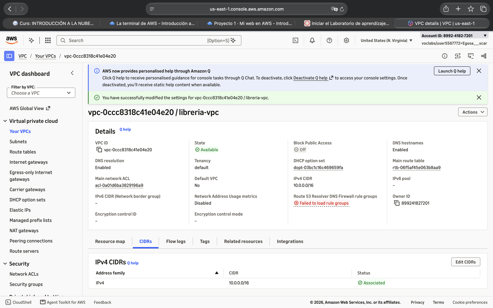

**Subred**

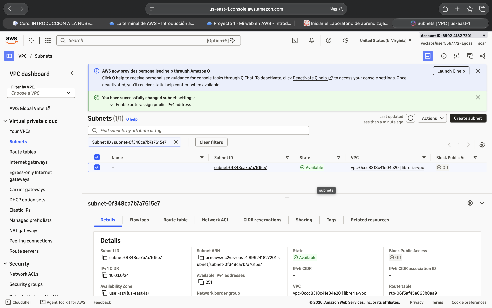

**Internet Gateway**

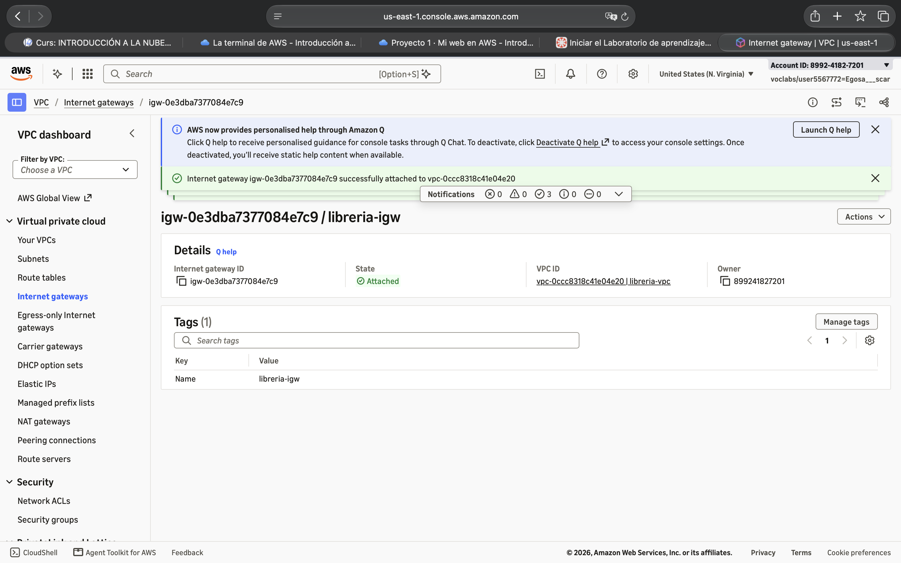

**Tabla de rutas** (rutas y asociación de subred)

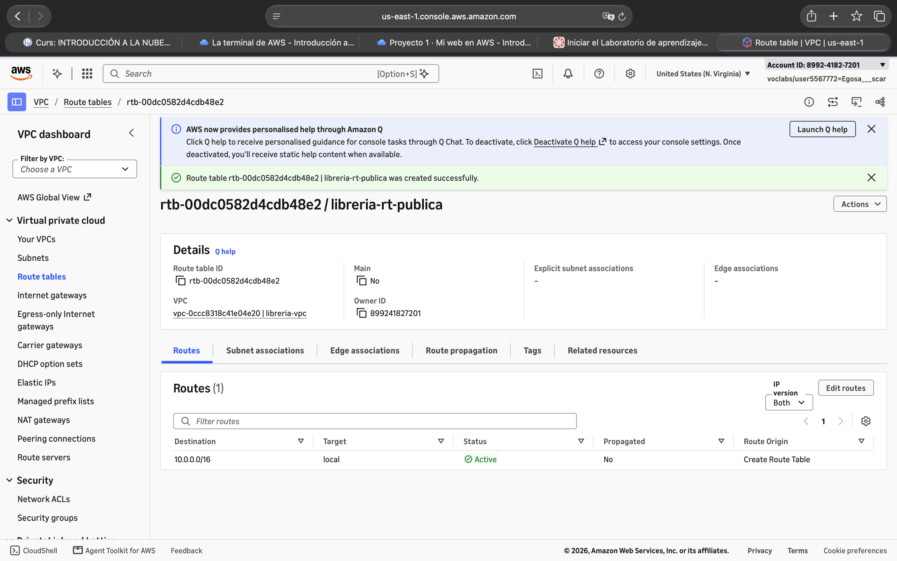

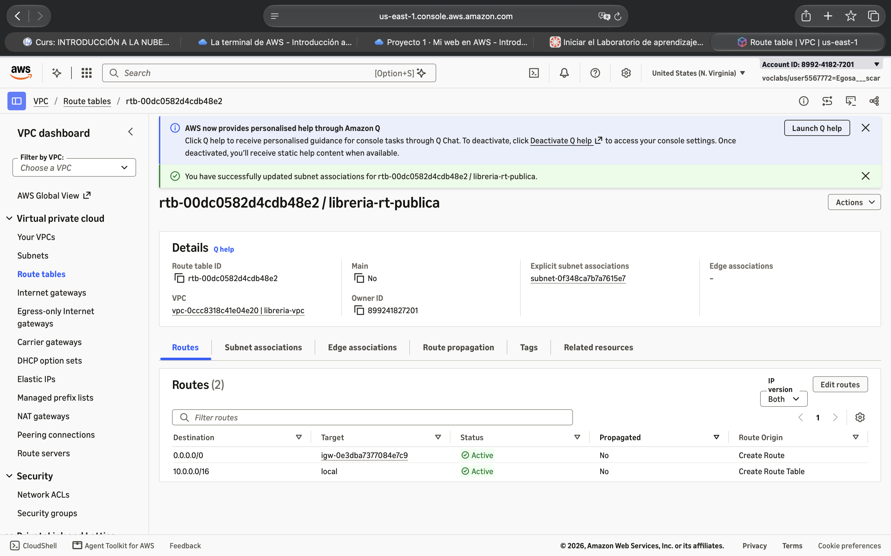

### ¿Por qué la subred es pública?

Una subred es pública porque su tabla de rutas envía el tráfico `0.0.0.0/0` al Internet Gateway, y porque asigna IP pública automáticamente a las instancias que se lanzan en ella. Sin la ruta al IGW, la instancia no tendría salida ni entrada desde Internet, aunque tuviera IP pública.

---

## 3. B2. La seguridad

Grupo de seguridad `libreria-web-sg`, creado en `libreria-vpc`, con estas reglas de entrada:

| Tipo | Puerto | Origen | Motivo |
|---|---|---|---|
| HTTP | 80 | `0.0.0.0/0` | Cualquier visitante debe poder ver la web |
| SSH | 22 | Solo mi IP (*Mi IP*) | Solo yo debo poder administrar el servidor |

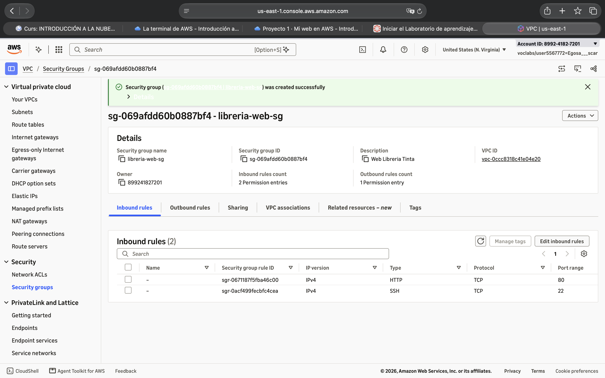

### ¿Por qué el SSH solo se abre a mi IP?

El SSH es el acceso de administración al servidor. Abrirlo a `0.0.0.0/0` expondría la máquina a intentos de acceso automatizados desde todo Internet. Limitándolo a mi IP, solo puedo conectarme yo, y el HTTP (80) es lo único que ve el público.

---

## 4. B3. El servidor web

Instancia `libreria-web`:

- **AMI:** Amazon Linux 2023
- **Tipo:** `t3.micro`
- **Par de claves:** `vockey`
- **Red:** `libreria-vpc`, subred `libreria-publica`, grupo `libreria-web-sg`
- **Etiquetas:** `Proyecto = P1`, `Alumno = Oscar Egosa`
- **Datos de usuario:** [`scripts/user-data1.sh`](scripts/user-data1.sh), que instala nginx y genera la página de la librería con horario, dirección y una recomendación de libro.

**Configuración de la instancia**

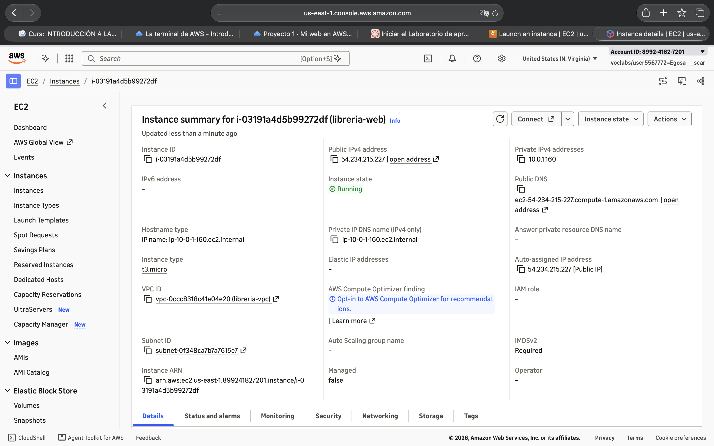

**Etiquetas**


**La web funcionando** (con la IP pública en la barra de direcciones)

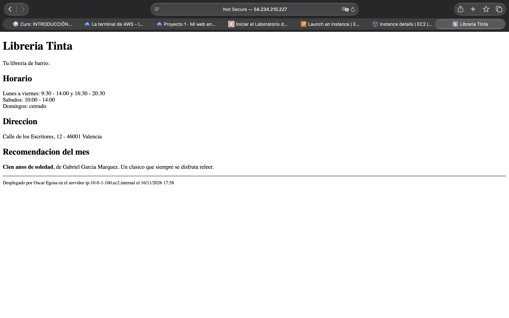

**Conexión SSH al servidor** (con la clave de `vockey`)

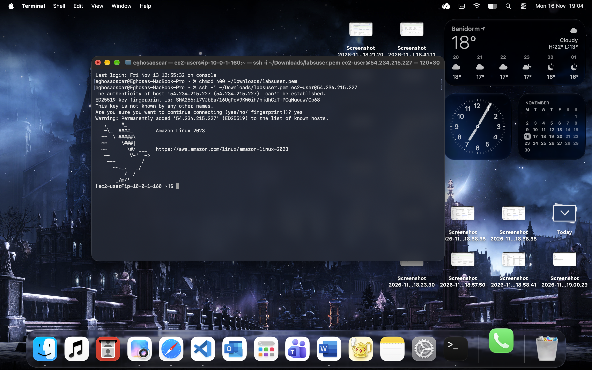

---

## 5. B4. Presupuesto

Estimación con la [AWS Pricing Calculator](https://calculator.aws/) para 1 instancia `t3.micro` (Linux, On-Demand) encendida 24/7 en `us-east-1`, con 8 GB de disco EBS gp3:

**Coste mensual: 8,23 USD** (98,76 USD al año).

Enlace de la estimación: https://calculator.aws/#/estimate?id=52e1d59038daebc997b3a03979a8d2a22661fd18

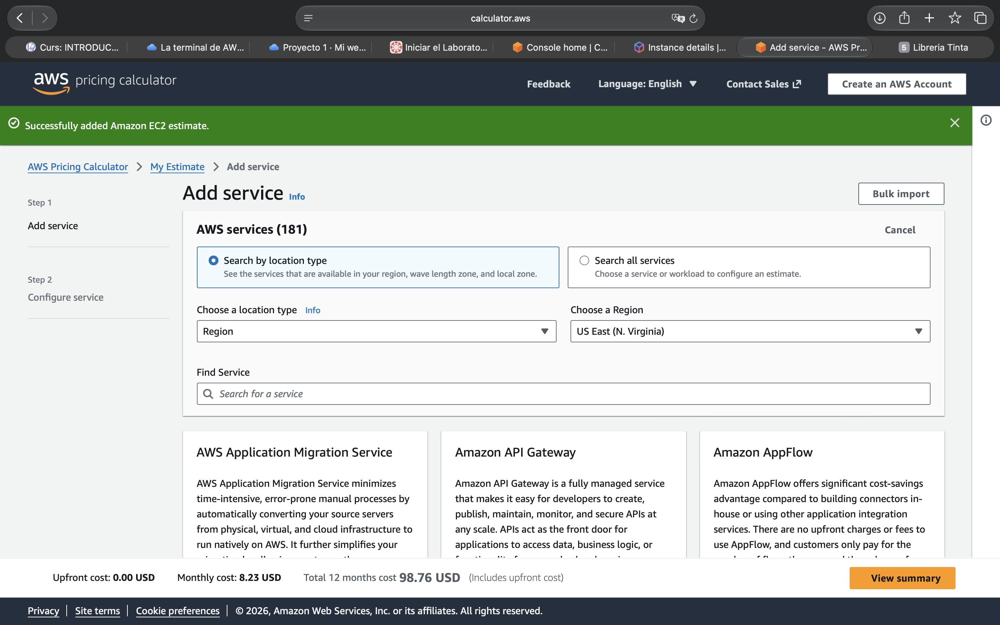

**Cómo abaratarlo:** se podría contratar una instancia reservada o un Savings Plan, o apagar el servidor fuera del horario comercial si la web no necesita estar siempre disponible.

---

## 6. Nivel medio: DNS ponderado con Route 53

### M1. Segundo servidor y reparto 80/20

Se lanzó una segunda instancia, `libreria-web-2`, en la misma VPC, subred y grupo de seguridad. Su página (generada con [`scripts/user-data2.sh`](scripts/user-data2.sh)) muestra «VERSION 2» y recomienda otro libro, para distinguirla de la del servidor 1.

| Servidor | IP privada |
|---|---|
| `libreria-web` (servidor 1) | `10.0.1.160` |
| `libreria-web-2` (servidor 2) | `10.0.1.139` |


Antes de crear la zona, se comprobó que `libreria-vpc` tiene activadas *Enable DNS resolution* y *Enable DNS hostnames* (esta última viene desactivada al crear la VPC a mano).

Se creó la zona alojada **privada** `libreria.lab`, asociada a `libreria-vpc`, con dos registros A para `web.libreria.lab` con el mismo nombre y tipo, identificadores distintos y TTL 0:

| Registro | Valor | Política | Peso | TTL | ID |
|---|---|---|---|---|---|
| `web.libreria.lab` | `10.0.1.160` | Ponderada | 80 | 0 | `servidor1` |
| `web.libreria.lab` | `10.0.1.139` | Ponderada | 20 | 0 | `servidor2` |


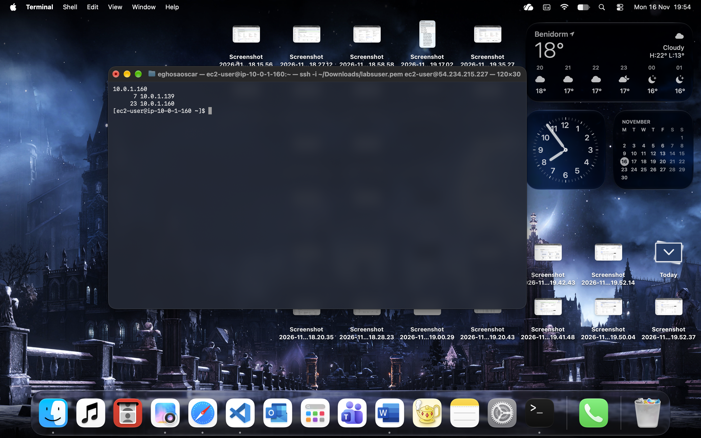

### Comprobación desde el servidor 1

La zona es privada, así que solo se resuelve dentro de la VPC. Por eso las pruebas se hicieron por SSH desde `libreria-web`.

**Resolución y reparto con `dig` (30 consultas):**

```bash
dig +short web.libreria.lab
for i in $(seq 1 30); do dig +short web.libreria.lab; done | sort | uniq -c
```

Resultado: 23 respuestas a `10.0.1.160` y 7 a `10.0.1.139`, coherente con el reparto 80/20 (la elección es aleatoria en cada consulta).

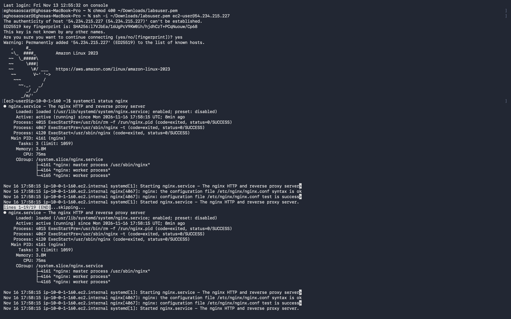

**Peticiones con `curl`:**

```bash
for i in $(seq 1 10); do curl -s http://web.libreria.lab | grep -o "VERSION 2\|Libreria Tinta</h1>"; done
```

Resultado: respuestas de ambos servidores, mayoritariamente del servidor 1.

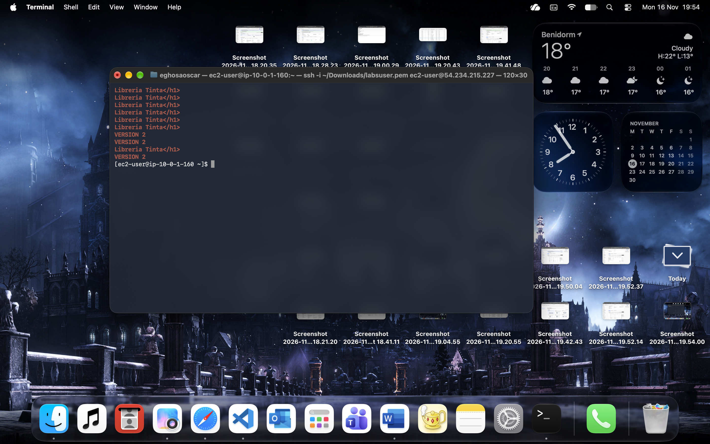

### M2. Presupuesto actualizado

Estimación para **2 servidores** `t3.micro` 24/7 y **1 zona alojada de Route 53** (1 millón de consultas al mes):

- EC2: 16,46 USD/mes
- Route 53: 0,90 USD/mes
- **Total: 17,36 USD al mes** (208,32 USD al año)

Enlace: https://calculator.aws/#/estimate?id=187c5429c9c89cfe5cd11619105b9571ec2601a2


---

## 7. Nivel avanzado: despliegue con la AWS CLI

> _Pendiente
---

## 8. Uso de IA

**Herramienta usada:** Claude (Anthropic).

**Prompts que me resultaron útiles**:

1. *«Empecemos por el B1 paso a paso»*: me guió en la creación de la VPC, la subred, el IGW y la tabla de rutas, y me recordó activar el DNS de nombres de host de la VPC para el nivel medio.
2. *«Prepárame el user-data1.sh personalizado con mis datos»*: me generó el script con el horario, la dirección y la recomendación de libro inventados.
3. *«Prepárame el diagrama en draw.io»*: me dio un fichero `.drawio` que importé y ajusté.

**Errores o propuestas incorrectas de la IA que detecté** _(comprueba que coincide con lo que viviste y cuéntalo a tu manera)_:

- **Sección equivocada en la calculadora.** Me indicó que en Route 53 rellenara un apartado llamado «Hosted Zones and Records», pero en la calculadora solo aparecía «Hosted Zones». Lo comprobé en la pantalla y lo rellené con el campo que sí existía. Después la IA lo corrigió.
- **Calculadora equivocada.** Primero acabé en la versión de la calculadora dentro de la consola de AWS (*Billing and Cost Management*), pero el enlace compartido que pide el proyecto sale de la calculadora pública, `calculator.aws`. Lo detecté porque no encontraba el botón *Create estimate* y lo resolví abriendo la web pública.
- **Aviso del modo del asistente de Route 53.** Me dijo que pulsara «Switch to wizard», pero la pantalla ya estaba en el asistente (el botón decía «Switch to quick create»). Lo vi al leer la pantalla y seguí con el asistente.

**Verificación:** las instrucciones las contrasté con el enunciado del proyecto y con lo que mostraba la consola, y las pruebas (`dig` y `curl`) las ejecuté yo en el servidor. No compartí credenciales de AWS con la IA.

---

## 9. Estructura del repositorio

```
proyecto1/
├── README.md
├── img/                 # capturas de pantalla y diagrama
└── scripts/
    ├── user-data1.sh
    ├── user-data2.sh    # nivel medio
 
```
